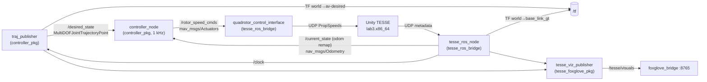
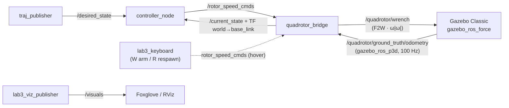

# VNAV Workspace — Project Overview Report

**Workspace:** `vnav_ws` · **Course:** MIT 16.485 *Visual Navigation for Autonomous Vehicles* (Fall 2024 materials) · **Stack:** ROS 2 Humble, C++17 / Python 3.10, Eigen, Unity (TESSE), Gazebo Classic, Foxglove
**Analysis date:** 2026-10-13

---

## 1. What this project is

A ROS 2 colcon workspace for **Lab 3: geometric tracking control of a quadrotor**. The student code is the controller from Lee, Leok & McClamroch, *"Geometric tracking control of a quadrotor UAV on SE(3)"* (CDC 2010). It turns a desired trajectory (position, velocity, acceleration, yaw) into **four signed rotor speeds**.

The controller can drive two interchangeable simulators:

| Backend | Where it lives | Status |
|---|---|---|
| **TESSE** (MIT's Unity sim, the official one) | `vnav_builds/lab3/lab3.x86_64` + `tesse_ros_bridge` + `tesse-interface` | Provided by the course and committed to git |
| **Gazebo Classic** (a substitute you built) | `src/gazebo_quadrotor_pkg` | ⚠️ **Not tracked by git** |

Foxglove visualization packages were added for both backends.

---

## 2. Repository layout

```
vnav_ws/
├── src/
│   ├── controller_pkg/          ★ Student code (C++): controller_node + traj_publisher
│   ├── gazebo_quadrotor_pkg/    ★ Your Gazebo substitute sim (Python, URDF, worlds) — untracked
│   ├── tesse_foxglove_pkg/      ★ Your Foxglove viz for TESSE — untracked
│   ├── tesse_ros_bridge/        Course-provided: Unity <-> ROS 2 bridge (rospy2 shim)
│   ├── tesse-interface/         Course-provided: Python UDP/TCP protocol to Unity
│   ├── tesse_msgs/              Course-provided: TESSE srv/msg definitions
│   └── mav_comm/                git submodule (ethz-asl): mav_msgs/Actuators, etc.
├── vnav_builds/lab3/            Unity player binary (~96 MB, tracked in git)
├── build/ install/ log/         colcon output (git-ignored)
├── foxglove.json                Foxglove layout (untracked)
└── .vscode/                     IntelliSense paths for ROS 2 Humble (untracked)
```

**Size:** about 180 source files. Hand-written or modified code is about 1.2 kLoC; the rest comes from the course or third parties.

---

## 3. System architecture

### 3.1 ROS graph: TESSE path



### 3.2 ROS graph: Gazebo path



In the Gazebo path the propellers are not simulated. `quadrotor_bridge` applies the same allocation matrix as the controller, turning rotor speeds into a body-frame wrench (thrust plus three torques), and `gazebo_ros_force` applies it to a 1 kg rigid box with J = I.

### 3.3 Topic contract

| Topic | Type | Producer | Consumer |
|---|---|---|---|
| `/desired_state` | `trajectory_msgs/MultiDOFJointTrajectoryPoint` | `traj_publisher` | `controller_node`, viz |
| `/current_state` | `nav_msgs/Odometry` | `tesse_ros_node` (remap of `odom`) **or** `quadrotor_bridge` | `controller_node`, viz |
| `/rotor_speed_cmds` | `mav_msgs/Actuators` (rad/s, signed) | `controller_node`, `lab3_keyboard` | `quadrotor_control_interface` **or** `quadrotor_bridge` |
| `/clock` | `rosgraph_msgs/Clock` | TESSE bridge / Gazebo | all nodes with `use_sim_time` |

---

## 4. Control design ([controller_node.cpp](../src/controller_pkg/src/controller_node.cpp))

### 4.1 Model constants

| Symbol | Value | Meaning |
|---|---|---|
| m | 1.0 kg | mass |
| g | 9.81 m/s² | gravity (z-up, ENU) |
| d | 0.3 m | arm length |
| c_f | 1e-3 | thrust coefficient (f = c_f·ω²) |
| c_d | 1e-5 | drag-torque coefficient (τ = c_d·ω²) |
| J | I₃ | inertia |

### 4.2 Control law (z-up convention)

| Step | Equation in code | Paper ref |
|---|---|---|
| Errors | e_x = x − x_d, e_v = v − v_d | (6), (7) |
| Desired thrust vector | A = −k_x e_x − k_v e_v + m g e₃ + m a_d | (12), sign flipped for z-up |
| Desired attitude | b₃d = A/‖A‖, b₂d = b₃d × b₁d(yaw) normalized, b₁d' = b₂d × b₃d | Fig. 3 |
| Attitude error | e_R = ½ (R_dᵀR − RᵀR_d)^∨ | (10) |
| Rate error | e_Ω = Ω (Ω_d term dropped) | (11), simplified |
| Thrust | F = A · (R e₃) | (15) |
| Moment | M = −k_R e_R − k_Ω e_Ω + Ω × JΩ | (16), Ω_d terms dropped |
| Allocation | [ω²] = F2W⁻¹ [F, M]ᵀ, ω = signed_sqrt(·) | (1) + lecture notes eq. 6.9 |

**Allocation matrix (X-configuration, arms 45° from body x):**

```
        ⎡ c_f   c_f   c_f   c_f ⎤        a = c_f · d / √2
F2W  =  ⎢  a     a    −a    −a  ⎥   → τx  ⇒ rotors 1,2 on +y side
        ⎢ −a     a     a    −a  ⎥   → τy  ⇒ rotors 1,4 on +x side
        ⎣ c_d  −c_d   c_d  −c_d ⎦   → τz  ⇒ rotors 1,3 vs 2,4 spin opposite ways
```

This gives rotor 1 = front-left, 2 = rear-left, 3 = rear-right, 4 = front-right (counter-clockwise numbering).

### 4.3 Gain analysis ([params.yaml](../src/controller_pkg/config/params.yaml))

| Loop | Gains | ω_n | ζ |
|---|---|---|---|
| Position (m = 1) | k_x = 8, k_v = 6 | √8 ≈ **2.83 rad/s** | 6 / (2·2.83) ≈ **1.06** |
| Attitude (J = I) | k_R = 90, k_Ω = 18 | √90 ≈ **9.49 rad/s** | 18 / (2·9.49) ≈ **0.95** |

Both loops are close to critically damped, so there should be little overshoot. The attitude loop is about **3.4×** faster than the position loop. That works, but it is at the low end of the usual 5–10× guideline for cascaded control. If you see coupling oscillations on the circle, raise k_R/k_Ω (for example 150/24) before touching the position gains. The original placeholder gains (k_v = 0.01) were almost undamped; the uncommitted tuning fixes that.

### 4.4 Reference trajectory ([traj_publisher.cpp](../src/controller_pkg/src/traj_publisher.cpp))

- **Circle:** radius 5 m at z = 2 m, angular rate 0.5 rad/s (period ≈ 12.6 s), flown clockwise seen from above.
- Speed is 2.5 m/s and centripetal acceleration is 1.25 m/s², so the steady tilt is about **7.3°**.
- Yaw = −t/2 matches the direction of travel, so the drone faces forward.
- Analytic velocity and acceleration feed-forward are published. They match the derivatives of the position.
- The uncommitted rewrite uses a **phase accumulator with clock-jump protection**:
  - It switched from a blocking `while` loop to a 1 ms wall timer.
  - It waits for the first `/clock` message.
  - It holds the target when the clock jumps by more than 0.2 s or goes backward, for example on a TESSE respawn.

  This is a solid improvement over the course template.

---

## 5. Development history

| Date | Commit / event | Notes |
|---|---|---|
| 2026-08-29 | `82e6b17` first commit, `4d4e15c` add simulator | Course template + Unity build |
| 2026-09-03 | `f76ef56` fixed topic mismatch and build error | |
| 2026-09-06 | `e3846e7` correct controller_node | Controller parts 1–5 done |
| 2026-09-16 → 10-04 | 11 colcon builds (all `rc = 0`) | Gazebo pkg (09-29), Foxglove pkg (10-04), traj publisher rework |
| *now* | **Uncommitted:** gains, launch, traj_publisher; **untracked:** 2 packages | ~1 month of work not in git |

---

## 6. How to run (as currently configured)

```bash
# Build (from vnav_ws)
colcon build && source install/setup.bash

# --- TESSE path ---
./vnav_builds/lab3/lab3.x86_64 &                           # Unity sim
ros2 launch tesse_ros_bridge tesse_quadrotor_bridge.launch.yaml
ros2 launch controller_pkg traj_tracking.launch.py         # traj_publisher only (controller is commented out)
ros2 run controller_pkg controller_node --ros-args \
     --params-file install/controller_pkg/share/controller_pkg/config/params.yaml
ros2 launch tesse_foxglove_pkg tesse_foxglove.launch.py    # optional, ws://localhost:8765

# --- Gazebo path ---
ros2 launch gazebo_quadrotor_pkg gazebo_quadrotor.launch.py
# then the same traj_tracking + controller_node commands as above
```

> [!NOTE]
> `controller_node` is commented out in [traj_tracking.launch.py](../src/controller_pkg/launch/traj_tracking.launch.py#L20-L26), so it has to be started on its own. When you do, also pass `use_sim_time:=true` so that message timestamps match the sim.

See **[02_code_review_findings.md](./02_code_review_findings.md)** for issues and recommendations.
